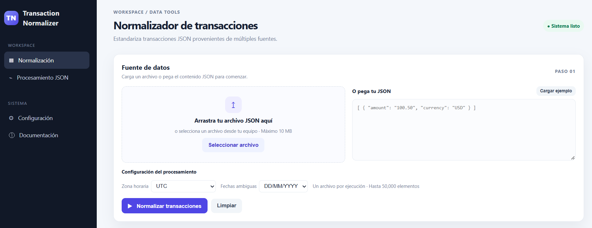
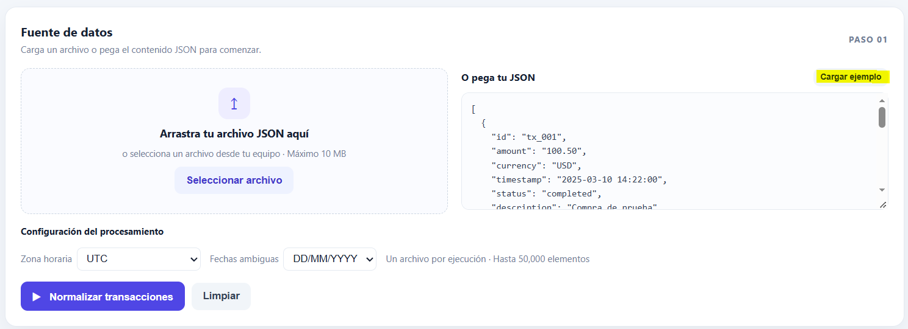
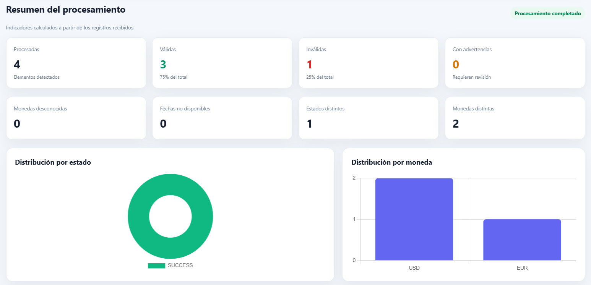
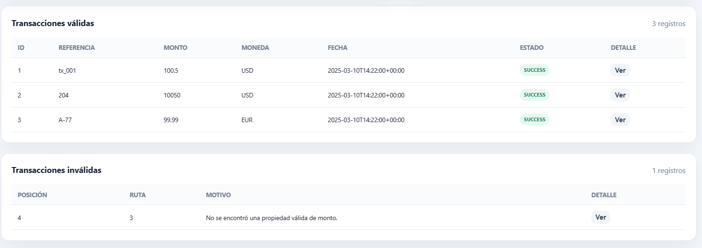
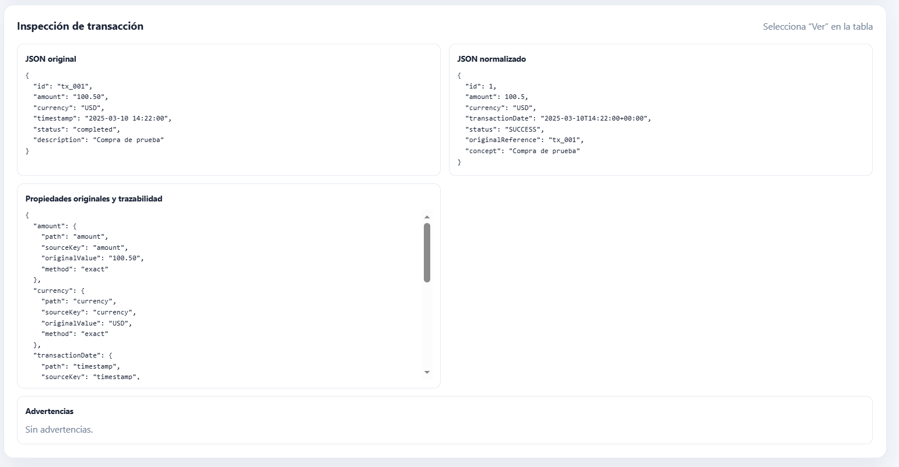
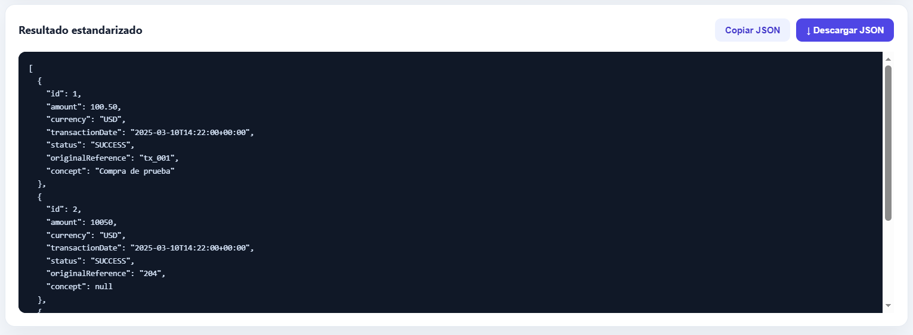

# Transaction Formatter

Aplicación web local para normalizar transacciones JSON provenientes de múltiples fuentes. Está construida con **FastAPI**, **Python**, **HTML**, **CSS** y **JavaScript**.

## Contenido

- [Características](#características)
- [Requisitos](#requisitos)
- [Instalación en Windows](#instalación-en-windows)
- [Instalación en Linux y macOS](#instalación-en-linux-y-macos)
- [Ejecución](#ejecución)
- [Guía práctica del dashboard](#guía-práctica-del-dashboard)
- [Capturas de pantalla en este README](#capturas-de-pantalla-en-este-readme)
- [Configuración](#configuración)
- [API](#api)
- [Reglas de normalización](#reglas-de-normalización)
- [Pruebas](#pruebas)
- [Solución de problemas](#solución-de-problemas)
- [Estructura del proyecto](#estructura-del-proyecto)
- [Limitaciones](#limitaciones)

## Características

- Carga de archivos `.json` o ingreso directo del contenido JSON.
- Acepta objetos individuales, arreglos y arreglos de transacciones dentro de contenedores anidados.
- Reconocimiento de campos en inglés y español mediante alias y coincidencia aproximada conservadora.
- Prioridad explícita de `total` sobre `amount` y `monto`.
- Conversión monetaria con `Decimal`; los enteros no se convierten automáticamente a centavos.
- Identificación conservadora de monedas ISO-4217.
- Normalización de fechas ISO-8601 y zonas horarias configurables.
- Normalización de estados a `SUCCESS`, `FAILED`, `PENDING` o `UNKNOWN`.
- Separación de transacciones válidas, inválidas, advertencias y trazabilidad.
- Dashboard con métricas, gráficos, tablas, inspección y descarga del JSON normalizado.
- Navegación lateral hacia procesamiento, configuración y documentación.
- Al seleccionar **Ver** en una tabla, la interfaz desplaza la página a la inspección de la transacción elegida.
- Sin base de datos ni almacenamiento persistente. El backend conserva temporalmente el último resultado en memoria.

## Requisitos

- Python **3.11 a 3.14 recomendado**. Python 3.10 o superior puede funcionar, pero las versiones más recientes de Python pueden tardar en recibir wheels de todas las dependencias.
- `pip` actualizado.
- Navegador moderno (Chrome, Edge o Firefox).
- Conexión a Internet para cargar Chart.js desde CDN y mostrar los gráficos. El procesamiento principal se ejecuta localmente.

> **Nota para Windows:** se recomienda crear un entorno virtual dentro de la carpeta del proyecto. Los comandos siguientes utilizan `python -m pip` para asegurar que `pip` corresponda al intérprete activo.

## Instalación en Windows

Abre PowerShell en la carpeta raíz del proyecto, donde se encuentran `requirements.txt` y `run.py`.

### 1. Comprobar Python

```powershell
py --version
py -0p
```

Si tienes varias versiones instaladas y deseas seleccionar Python 3.14, puedes crear el entorno así:

```powershell
py -3.14 -m venv .venv
```

Si el comando `py -3.14` no está disponible, instala una versión compatible de Python o utiliza el ejecutable `python` que tengas configurado:

```powershell
python -m venv .venv
```

### 2. Activar el entorno virtual

```powershell
.\.venv\Scripts\Activate.ps1
```

Si PowerShell bloquea la activación por la política de ejecución, permite scripts únicamente en la sesión actual:

```powershell
Set-ExecutionPolicy -Scope Process -ExecutionPolicy Bypass
.\.venv\Scripts\Activate.ps1
```

Esta modificación se limita a la ventana actual de PowerShell.

### 3. Actualizar pip e instalar dependencias

```powershell
python -m pip install --upgrade pip
python -m pip install -r requirements.txt
python -m pip check
```

Si `pip check` no reporta dependencias incompatibles, la instalación está lista.

### 4. Ejecutar

```powershell
python run.py
```

Abre en el navegador: <http://127.0.0.1:8000>

## Instalación en Linux y macOS

Desde la carpeta raíz del proyecto:

```bash
python3 -m venv .venv
source .venv/bin/activate
python -m pip install --upgrade pip
python -m pip install -r requirements.txt
python -m pip check
python run.py
```

Abre <http://127.0.0.1:8000> en el navegador.

## Ejecución

El servidor se inicia desde la raíz del proyecto:

```bash
python run.py
```

Direcciones disponibles:

- Dashboard: <http://127.0.0.1:8000>
- Documentación interactiva de la API (Swagger UI): <http://127.0.0.1:8000/docs>
- Especificación OpenAPI: <http://127.0.0.1:8000/openapi.json>

Para detener el servidor, vuelve a la terminal y presiona `Ctrl + C`.

## Guía práctica del dashboard

Esta sección describe un flujo de trabajo recomendado para procesar y revisar un conjunto de transacciones.

### 1. Abrir el dashboard y localizar sus secciones

Al iniciar la aplicación se muestra el área principal. El menú lateral permite navegar entre **Normalización**, **Procesamiento JSON**, **Configuración** y **Documentación**. Las opciones desplazan la página hasta la sección correspondiente.

### 2. Cargar datos JSON

En **Fuente de datos** puedes:

- Pulsar **Seleccionar archivo** para elegir un archivo `.json` de tu equipo.
- Arrastrar un archivo JSON hasta el área de carga.
- Pegar el contenido JSON directamente en el editor.
- Pulsar **Cargar ejemplo** para completar el editor con registros de demostración.

El tamaño máximo predeterminado de entrada es de 10 MB.

### 3. Configurar el procesamiento

Antes de normalizar, selecciona:

- **Zona horaria:** define cómo interpretar las fechas sin zona horaria y a qué zona convertir las fechas que sí incluyen zona.
- **Fechas ambiguas:** selecciona `DD/MM/YYYY` (DMY) o `MM/DD/YYYY` (MDY) para fechas numéricas que puedan interpretarse de ambas maneras.

Por ejemplo, `10/03/2025` puede representar el 10 de marzo o el 3 de octubre, dependiendo de la opción elegida.

### 4. Ejecutar la normalización

Pulsa **Normalizar transacciones**. La aplicación enviará el contenido al backend y presentará el resumen del procesamiento.

Si el JSON no puede interpretarse o no contiene transacciones detectables, se mostrará un mensaje con el motivo. Corrige el contenido y vuelve a intentarlo.

### 5. Interpretar el resumen

El dashboard presenta indicadores como:

- **Procesadas:** cantidad total de elementos detectados.
- **Válidas:** registros que contienen un monto interpretable.
- **Inválidas:** registros que no pudieron normalizarse, por ejemplo, por falta de monto.
- **Con advertencias:** transacciones válidas que requieren atención en uno o más campos.
- **Monedas desconocidas** y **fechas no disponibles:** indicadores de calidad de datos.
- **Distribución por estado y moneda:** gráficos que resumen los registros válidos.

### 6. Consultar transacciones válidas e inválidas

Las tablas permiten revisar los registros de cada categoría:

- En **Transacciones válidas**, revisa el monto, moneda, fecha y estado normalizados.
- En **Transacciones inválidas**, revisa la posición, ruta de origen y motivo del rechazo.
- Pulsa **Ver** para abrir la inspección del registro seleccionado. La página se desplaza automáticamente a **Inspección de transacción**.

La inspección permite comparar el JSON original con el resultado normalizado y consultar la trazabilidad, los campos detectados, las advertencias o los errores.

### 7. Exportar el resultado

En **Resultado estandarizado**:

- **Copiar JSON:** copia el resultado normalizado al portapapeles. El navegador puede solicitar permiso para utilizarlo.
- **Descargar JSON:** descarga el resultado como `transacciones_normalizadas.json`.

### 8. Reiniciar la entrada

Pulsa **Limpiar** para borrar la entrada actual y ocultar los resultados de la interfaz. El procesamiento nuevo sustituye al resultado anterior almacenado temporalmente en el backend.

## Secciones principales

### Dashboard

### Datos de entrada

### Resumen

### Detalle de transacciones

### Detalle individual por transacción

### JSON formateado


## Configuración

Las siguientes variables de entorno permiten ajustar los límites y valores predeterminados:

| Variable | Valor predeterminado | Descripción |
|---|---:|---|
| `MAX_FILE_BYTES` | `10485760` | Tamaño máximo de entrada en bytes (10 MB). |
| `MAX_TRANSACTIONS` | `50000` | Máximo de elementos transaccionales detectados. |
| `MAX_DEPTH` | `10` | Profundidad máxima de exploración de estructuras JSON. |
| `DEFAULT_TIMEZONE` | `UTC` | Zona horaria predeterminada (identificador IANA). |
| `DEFAULT_DATE_ORDER` | `DMY` | Orden predeterminado de fechas ambiguas: `DMY` o `MDY`. |
| `FUZZY_THRESHOLD` | `0.91` | Umbral de similitud textual para detectar campos. |

Ejemplo en PowerShell:

```powershell
$env:DEFAULT_TIMEZONE="America/El_Salvador"
$env:DEFAULT_DATE_ORDER="DMY"
python run.py
```

La interfaz también permite seleccionar la zona horaria y el orden de fechas para cada ejecución.

## API

| Método | Endpoint | Descripción |
|---|---|---|
| `GET` | `/api/health` | Estado del servicio. |
| `POST` | `/api/process` | Procesa un archivo multipart (`file` o `json_text`) o un cuerpo JSON. |
| `GET` | `/api/results/{processing_id}` | Devuelve el JSON normalizado. |
| `GET` | `/api/metrics/{processing_id}` | Devuelve las métricas del procesamiento. |
| `GET` | `/api/transactions/{processing_id}?kind=valid\|invalid` | Lista transacciones válidas o inválidas. |
| `GET` | `/api/transactions/{processing_id}/{transaction_id}` | Devuelve el detalle de una transacción válida. |
| `GET` | `/api/export/{processing_id}` | Descarga el resultado normalizado. |

El último procesamiento se conserva temporalmente en memoria. Una nueva ejecución reemplaza el resultado anterior y reiniciar el servidor elimina los resultados. No se utiliza una base de datos.

## Reglas de normalización

### Monto

`total`, `transactionTotal`, `totalAmount` y `totalTransaccion` tienen prioridad sobre `amount`, `transactionAmount`, `monto` y `montoTransaccion`. Los enteros conservan su escala: `10050` no se transforma en `100.50`. Se aceptan montos negativos y cero. Se utiliza `Decimal` internamente.

### Moneda

Una propiedad explícita válida prevalece sobre el código ISO embebido en el importe. Los símbolos ambiguos no se utilizan para adivinar la moneda. La lista de símbolos inequívocos soportados está en `app/core/constants.py`.

### Fechas

Las fechas sin zona se interpretan en la zona configurada. Las fechas con zona se convierten a la zona configurada. La ausencia de fecha se representa como `null` sin invalidar ni advertir; una fecha presente pero no interpretable genera una advertencia. El resultado incluye el offset ISO-8601. Para fechas como `10/03/2025`, la interfaz permite elegir DMY o MDY.

### Estado

Las equivalencias iniciales se encuentran en `app/core/constants.py` y pueden ampliarse. Un estado no reconocido se convierte en `UNKNOWN`.

### Transacciones inválidas

La falta de monto o un monto no convertible invalida el registro. Fecha, moneda, referencia y concepto pueden ser `null`. Los elementos que no sean objetos se reportan como inválidos.

## Pruebas

Desde la raíz del proyecto y con el entorno virtual activado:

```powershell
python -m pytest -q
```

## Solución de problemas

### `python` o `py` no se reconoce como comando

Python no está instalado o no está agregado al `PATH`.

- Comprueba si el lanzador de Windows está disponible: `py --version`.
- Comprueba las versiones detectadas: `py -0p`.
- Si ninguno funciona, instala Python desde <https://www.python.org/downloads/> y habilita la opción para agregar Python al `PATH` durante la instalación.
- Cierra y vuelve a abrir PowerShell después de instalarlo.

### `pip` no se reconoce o instala paquetes en otro Python

Evita ejecutar `pip` directamente. Utiliza siempre:

```powershell
python -m pip --version
python -m pip install -r requirements.txt
```

La ruta que muestra `python -m pip --version` debe corresponder al entorno virtual activo (`.venv`). Si no corresponde, activa el entorno desde la carpeta del proyecto y vuelve a ejecutar el comando.

### PowerShell no permite activar `.venv`

Ejecuta en la misma ventana:

```powershell
Set-ExecutionPolicy -Scope Process -ExecutionPolicy Bypass
.\.venv\Scripts\Activate.ps1
```

### `Microsoft Visual C++ 14.0 or greater is required` o `Failed building wheel for PyYAML`

La configuración actual utiliza `uvicorn` sin el extra `[standard]`, por lo que PyYAML no es una dependencia necesaria para ejecutar esta aplicación. Comprueba que `requirements.txt` contenga:

```text
uvicorn>=0.30,<1.0
```

No debe decir `uvicorn[standard]` ni incluir PyYAML si no se necesita por otra razón. Después, con el entorno virtual activado, ejecuta:

```powershell
python -m pip install --upgrade pip
python -m pip install -r requirements.txt
python -m pip check
```

Si el error persiste, revisa qué paquete solicita PyYAML en el mensaje completo de instalación. En Python muy reciente puede que alguna dependencia todavía no publique wheels compatibles; prueba con Python 3.14 o 3.13 en un entorno virtual nuevo. No instales paquetes de compilación de terceros como primera solución.

### `ModuleNotFoundError: No module named 'jinja2'`

Jinja2 es necesario para renderizar `index.html`. Instálalo en el entorno activo y verifica que esté declarado en `requirements.txt`:

```powershell
python -m pip install "Jinja2>=3.1,<4.0"
python -m pip check
```

### `ModuleNotFoundError` para otra dependencia

Comprueba que el entorno virtual esté activo y reinstala las dependencias declaradas:

```powershell
python -m pip install -r requirements.txt
python -m pip check
```

Si el módulo sigue faltando, confirma que `python` y `pip` pertenecen al mismo entorno:

```powershell
where.exe python
python -m pip --version
```

### Error de plantilla `TypeError: cannot use 'tuple' as a dict key`

Comprueba que el endpoint principal en `app/main.py` use la llamada compatible con las versiones actuales de Starlette:

```python
return templates.TemplateResponse(
    request=request,
    name="index.html"
)
```

Y que `Request` esté importado desde FastAPI:

```python
from fastapi import FastAPI, Request
```

### `Address already in use` o el puerto 8000 está ocupado

Otra aplicación está utilizando el puerto 8000. Cierra el proceso que lo ocupa o cambia el puerto en `run.py`. Por ejemplo, para utilizar el puerto 8001, modifica la llamada de Uvicorn a:

```python
uvicorn.run("app.main:app", host="127.0.0.1", port=8001, reload=True)
```

Después abre <http://127.0.0.1:8001>.

### La página carga, pero los gráficos no aparecen

Chart.js se obtiene desde un CDN. Comprueba la conexión a Internet y que el navegador no esté bloqueando `cdn.jsdelivr.net`. La carga y normalización de datos no dependen de los gráficos.

### El navegador muestra `404` para `/favicon.ico`

Este mensaje solo indica que no se ha definido un icono de pestaña. No impide el funcionamiento del dashboard ni del procesamiento.

### La API responde `404` al consultar un procesamiento anterior

Los resultados se guardan únicamente en memoria y solo se conserva el último procesamiento. Ejecutar otro procesamiento o reiniciar el servidor reemplaza o elimina el resultado anterior. Vuelve a cargar y procesar el JSON.

## Estructura del proyecto

```text
transaction-normalizer/
├── app/
│   ├── api/
│   ├── core/
│   ├── models/
│   ├── services/
│   ├── utils/
│   ├── static/
│   │   ├── css/
│   │   └── js/
│   └── main.py
├── docs/
│   └── screenshots/
├── templates/
├── tests/
├── requirements.txt
├── run.py
└── README.md
```

## Limitaciones

- La detección de arreglos transaccionales utiliza señales de campos conocidas. Un formato de fuente completamente nuevo podría requerir agregar alias.
- La similitud textual es deliberadamente conservadora para evitar asignaciones incorrectas.
- Un símbolo monetario solo se resuelve cuando la configuración contiene una correspondencia inequívoca. `$`, `¥` y `₱` no se infieren.
- Los formatos de fecha se pueden ampliar en `app/services/date_normalizer.py`.
- La caché de resultados es volátil y está pensada para ejecución local de un solo usuario; no constituye almacenamiento compartido multiusuario.
- Chart.js se carga desde CDN, por lo que los gráficos requieren conexión a Internet. El procesamiento y el resto de la aplicación funcionan localmente.
